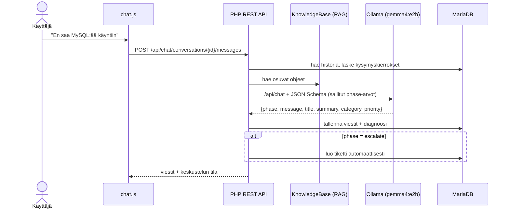
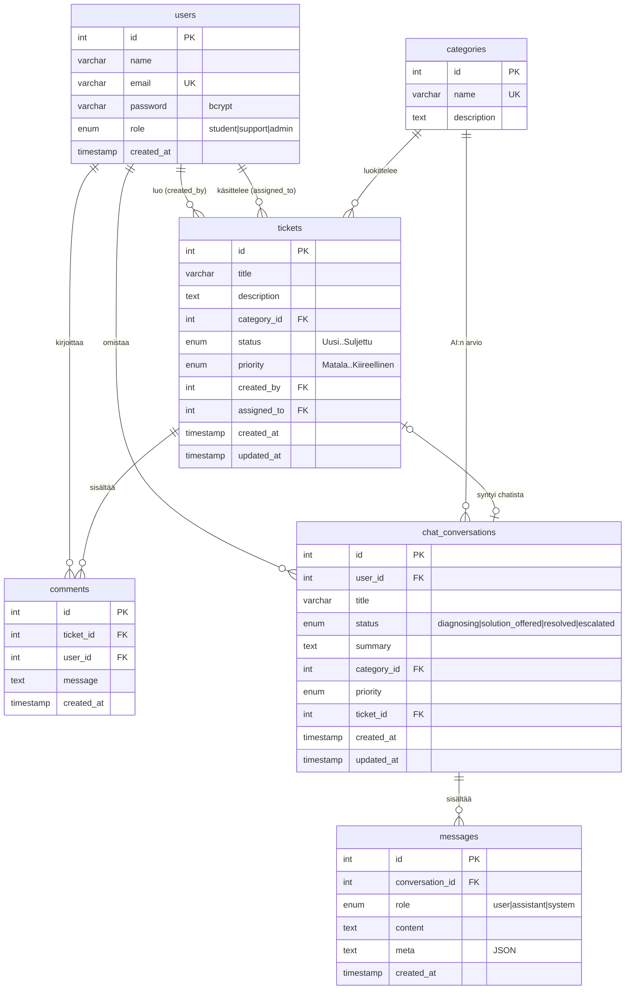
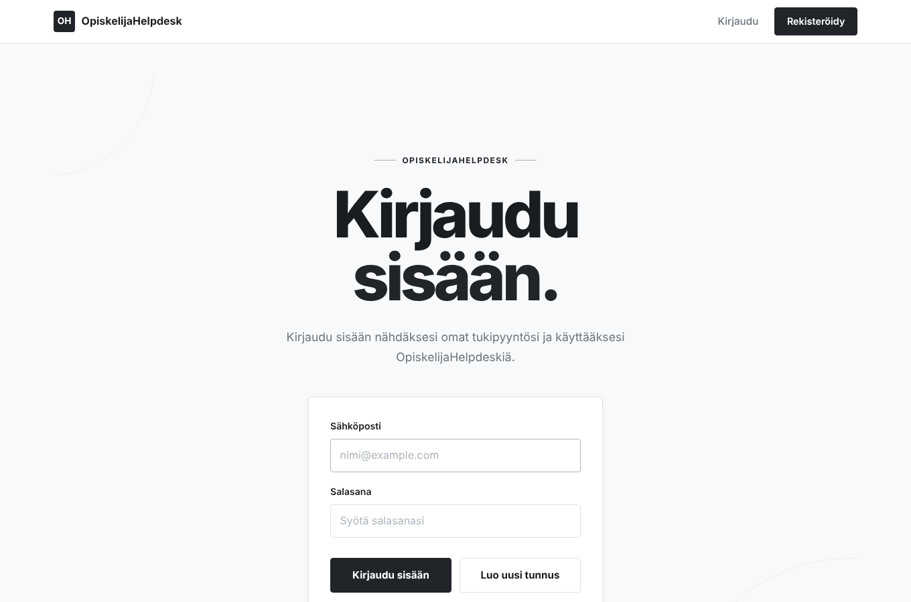
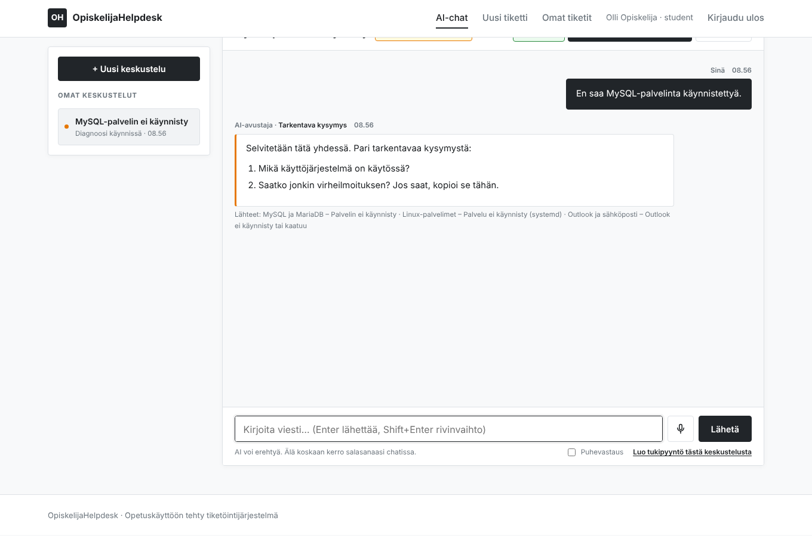
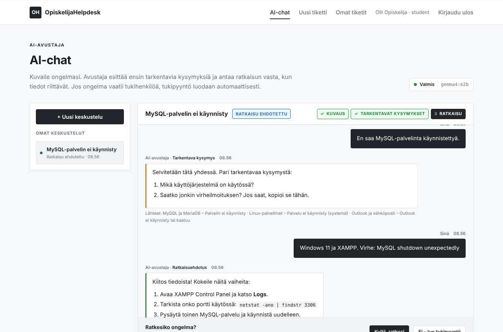
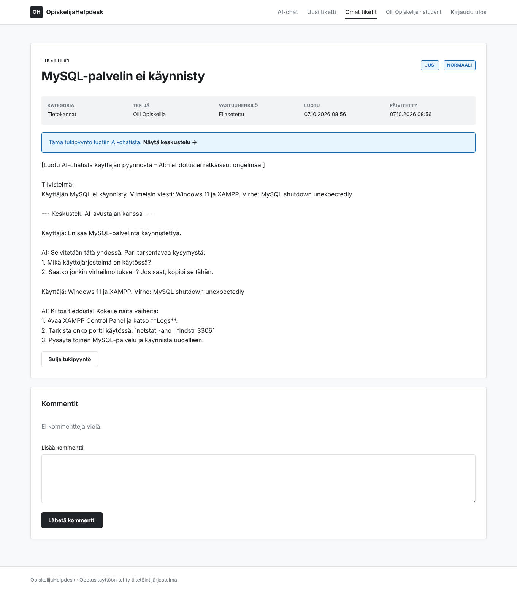
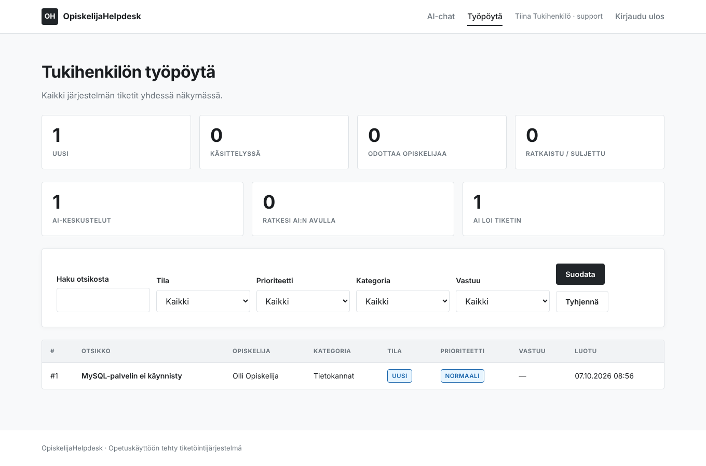
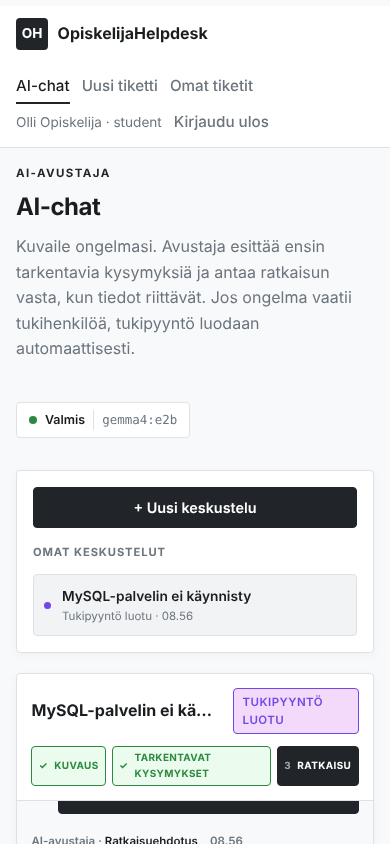

# OpiskelijaHelpdesk – AI HelpDesk

Tekoälyä hyödyntävä HelpDesk-järjestelmä IT- ja ohjelmistokehitysongelmiin.
Opiskelija kuvaa ongelmansa AI-avustajalle, joka **selvittää ensin tilanteen tarkentavilla
kysymyksillä** ja antaa ratkaisun vasta, kun tiedot riittävät. Jos ongelma vaatii ihmistä,
avustaja **luo tukipyynnön automaattisesti** tiivistelmän ja koko keskustelun kanssa.
Tukihenkilöt käsittelevät tiketit omalla työpöydällään.

Tekoälynä toimii paikallinen **Ollama**-palvelin, oletusmallina **`gemma4:e2b`**.
Koko sovellus käynnistyy Dockerilla yhdellä komennolla.

---

## Sisällys

1. [Ominaisuudet](#ominaisuudet)
2. [Teknologiat](#teknologiat)
3. [Asennus Dockerilla (suositus)](#asennus-dockerilla-suositus)
4. [Asennus ilman Dockeria](#asennus-ilman-dockeria)
5. [Käyttöohjeet](#käyttöohjeet)
6. [AI-chatin toiminta](#ai-chatin-toiminta)
7. [Projektin rakenne](#projektin-rakenne)
8. [Tietokanta](#tietokanta)
9. [REST API](#rest-api)
10. [Käyttöliittymäkuvat](#käyttöliittymäkuvat)
11. [Asetukset](#asetukset)

---

## Ominaisuudet

**Pakolliset**

| Vaatimus | Toteutus |
|---|---|
| Käyttäjähallinta | Rekisteröinti, kirjautuminen, omien tietojen ja salasanan muokkaus (`/profile`), roolit opiskelija / tukihenkilö / ylläpitäjä |
| Tukipyyntöjen hallinta | Luonti, omat tiketit, suodatus, kommentit, sulkeminen; tukihenkilöllä tila, prioriteetti ja vastuuhenkilö |
| AI-chat | Diagnoosi ensin -keskustelu Ollaman kautta, kirjautuminen vaaditaan |
| Tietokanta | MariaDB / MySQL: `users`, `tickets`, `messages` + `categories`, `comments`, `chat_conversations` |
| REST API | `GET /api/tickets`, `POST /api/ticket`, `PUT /api/ticket/{id}`, `DELETE /api/ticket/{id}` + chat-rajapinnat |

**Lisäominaisuudet**

- **Docker-julkaisu** – `docker compose up -d --build` käynnistää sovelluksen, tietokannan, Ollaman ja lataa mallin
- **RAG** – AI hakee vastauksia yrityksen ohjeista (`knowledge/*.md`) ja näyttää käytetyt lähteet
- **Automaattinen tukitiketti** – AI eskaloi ongelmat, joita ei voi ratkaista etänä
- **Dashboard** – tukihenkilön työpöydällä tikettien ja AI-keskustelujen tilastot
- **Puheohjaus ja puhevastaus** – mikrofonipainike ja "Puhevastaus"-valinta (selaimen Web Speech API)
- **Monikielisyys** – AI vastaa samalla kielellä kuin käyttäjä (suomi / englanti)

---

## Teknologiat

| Osa | Teknologia |
|---|---|
| Backend | PHP 8.2+ (ei ulkoisia riippuvuuksia), oma kevyt reititin, PDO |
| Frontend | Palvelinpuolen PHP-näkymät, puhdas CSS, vanilla JavaScript (AI-chat REST API:n kautta) |
| Tietokanta | MariaDB 11 / MySQL 8 |
| Tekoäly | Ollama + `gemma4:e2b` (structured outputs / JSON Schema) |
| Julkaisu | Docker, Docker Compose, Apache (`mod_rewrite`) |

---

## Asennus Dockerilla (suositus)

Vaatimukset: Docker Desktop tai Docker Engine + Compose. Malli vie levyltä useita gigatavuja
ja tarvitsee vähintään ~8 Gt keskusmuistia.

```bash
# 1. (valinnainen) omat asetukset
cp .env.example .env

# 2. käynnistä kaikki
docker compose up -d --build

# 3. seuraa mallin latausta (vain ensimmäisellä kerralla)
docker compose logs -f ollama-pull
```

Avaa **http://localhost:8080**.

| Palvelu | Kuvaus |
|---|---|
| `app` | PHP 8.3 + Apache, document root = `public/` |
| `db` | MariaDB 11, `database/schema.sql` ajetaan automaattisesti ensimmäisellä käynnistyksellä |
| `ollama` | Paikallinen Ollama-palvelin (mallit tallessa volyymissa `ollama_data`) |
| `ollama-pull` | Lataa mallin `gemma4:e2b` kerran ja sammuu |
| `phpmyadmin` | Valinnainen: `docker compose --profile tools up -d` → http://localhost:8081 |

Hyödyllisiä komentoja:

```bash
docker compose ps                     # tila
docker compose logs -f app            # sovelluksen lokit
docker compose down                   # pysäytä
docker compose down -v                # pysäytä ja poista tietokanta + mallit (aloita alusta)
docker compose exec ollama ollama ls  # ladatut mallit
```

**NVIDIA-näytönohjain:** `docker compose -f docker-compose.yml -f docker-compose.gpu.yml up -d --build`

**Ollama jo asennettuna koneelle?** Aseta `.env`-tiedostoon
`OLLAMA_URL=http://host.docker.internal:11434` ja aja `ollama pull gemma4:e2b` koneella.

**Kehitys:** poista `docker-compose.yml`:stä kommentti `volumes: - ./:/var/www/html`,
niin koodimuutokset näkyvät ilman uudelleenrakennusta.

---

## Asennus ilman Dockeria

1. Asenna PHP 8.2+ (`pdo_mysql`, `curl`, `mbstring`), MariaDB/MySQL ja [Ollama](https://ollama.com).
2. Lataa malli: `ollama pull gemma4:e2b`
3. Luo tietokanta ja aja rakenne:
   ```bash
   mysql -u root -p -e "CREATE DATABASE helpdesk CHARACTER SET utf8mb4 COLLATE utf8mb4_unicode_ci"
   mysql -u root -p helpdesk < database/schema.sql
   ```
   (tai phpMyAdmin → valitse tietokanta → Tuo → `database/schema.sql`)
4. Kopioi `config/config.example.php` → `config/config.php` ja täytä tietokanta-asetukset
   (tai aseta ympäristömuuttujat `DB_HOST`, `DB_NAME`, `DB_USER`, `DB_PASS`, `OLLAMA_URL`).
5. Käynnistä:
   - **Kehityspalvelin:** `php -S localhost:8000 -t public public/index.php` → http://localhost:8000
   - **Apache:** osoita document root `public/`-kansioon ja salli `.htaccess` (`AllowOverride All`, `mod_rewrite`).
     Jos document rootia ei voi vaihtaa (esim. jaettu webhotelli), projektin juuren `.htaccess`
     ohjaa pyynnöt `public/`-kansioon automaattisesti – myös alikansiossa (esim. `/~tunnus/helpdesk/`).

**Olemassa oleva tietokanta:** `schema.sql` on turvallista ajaa uudelleen (`IF NOT EXISTS`) –
se lisää uudet taulut `chat_conversations` ja `messages` sekä uudet kategoriat koskematta vanhaan dataan.

---

## Käyttöohjeet

**Testitunnukset** (luodaan `schema.sql`:ssä – vaihda tai poista tuotannossa):

| Rooli | Sähköposti | Salasana |
|---|---|---|
| Ylläpitäjä | admin@example.com | Admin1234! |
| Opiskelija | opiskelija@example.com | Opiskelija123! |
| Tukihenkilö | tuki@example.com | Tuki1234! |

**Opiskelija**
1. Rekisteröidy tai kirjaudu sisään.
2. Avaa **AI-chat** ja kuvaile ongelma (tai valitse valmis esimerkki).
3. Vastaa avustajan tarkentaviin kysymyksiin.
4. Kun saat ratkaisuehdotuksen, valitse **Kyllä, ratkesi** tai **Ei – luo tukipyyntö**.
5. Seuraa tikettejä kohdassa **Omat tiketit**, kommentoi ja sulje kun asia on hoidettu.

**Tukihenkilö** – **Työpöytä** näyttää kaikki tiketit ja tilastot. Tiketin voi ottaa käsittelyyn,
muuttaa tilaa/prioriteettia, kommentoida ja avata AI-keskustelun (vain luku), josta tiketti syntyi.

**Ylläpitäjä** – lisäksi käyttäjien, roolien ja kategorioiden hallinta (**Ylläpito**).

---

## AI-chatin toiminta



### Diagnoosi ensin – miten se on taattu

Malli vastaa aina rakenteisena JSONina (Ollaman *structured outputs*):

```json
{
  "phase": "question | solution | escalate",
  "message": "käyttäjälle näytettävä teksti",
  "title": "lyhyt otsikko",
  "summary": "tiivistelmä tukihenkilölle",
  "category": "Tietokannat",
  "priority": "Normaali"
}
```

Pieni malli ei aina noudata kehotetta, joten **palvelin päättää joka vuorolla, mitkä
`phase`-arvot ovat sallittuja**, ja antaa ne mallille JSON Scheman `enum`-listana. Malli ei
teknisesti voi tuottaa muuta arvoa:

| Tarkentavia kysymyskierroksia | Sallitut `phase`-arvot | Merkitys |
|---|---|---|
| < `CHAT_MIN_QUESTION_ROUNDS` (oletus 1) | `question` | Pakko kysyä ensin |
| välissä | `question`, `solution`, `escalate` | Malli päättää, riittävätkö tiedot |
| ≥ `CHAT_MAX_QUESTION_ROUNDS` (oletus 4) | `solution`, `escalate` | Pakko tehdä päätös |

- **question** → tarkentavia kysymyksiä (käyttöjärjestelmä, virheilmoitus, mitä on kokeiltu …)
- **solution** → numeroitu ratkaisu; käyttäjä merkitsee ratkenneeksi tai pyytää tikettiä
- **escalate** → tiketti luodaan automaattisesti (kategoria, prioriteetti, tiivistelmä ja keskustelu)

### RAG

`services/KnowledgeBase.php` pilkkoo `knowledge/`-kansion Markdown-ohjeet `##`-otsikoiden kohdalta
ja hakee käyttäjän viesteihin osuvimmat palat (TF-IDF-pisteytys, kevyt suomen kielen sanavartalo).
Palat liitetään järjestelmäkehotteeseen ja näytetään vastauksen alla kohdassa *Lähteet*.
Uuden ohjeen lisääminen = uusi `.md`-tiedosto kansioon.

---

## Projektin rakenne

```
helpdesk/
├── public/                  # AINOA selaimelle näkyvä kansio (document root)
│   ├── index.php            # front controller – kaikki pyynnöt tulevat tänne
│   ├── .htaccess            # mod_rewrite -> index.php
│   ├── css/style.css
│   └── js/app.js, chat.js
├── router/
│   ├── Router.php           # kevyt reititin ({id}-parametrit, GET/POST/PUT/DELETE)
│   ├── web.php              # HTML-sivujen reitit
│   └── api.php              # REST API -reitit
├── controllers/             # pyyntöjen käsittely
│   ├── AuthController.php, ProfileController.php, TicketController.php,
│   │   StaffController.php, AdminController.php, ChatController.php, HomeController.php
│   └── Api/TicketApiController.php, Api/ChatApiController.php
├── services/                # sovelluslogiikka
│   ├── ChatService.php      # diagnoosilogiikka, kehotteet, tikettien luonti
│   ├── OllamaClient.php     # Ollama REST -asiakas
│   ├── KnowledgeBase.php    # RAG-haku
│   └── TicketRepository.php # tikettikyselyt
├── views/                   # PHP-näkymät
│   ├── layouts/header.php, footer.php
│   ├── home.php, auth/, tickets/, staff/, admin/, profile/, chat/, errors/
├── core/                    # bootstrap, tietokanta, autentikointi, apufunktiot
├── config/                  # config.example.php (+ oma config.php)
├── database/schema.sql      # tietokannan rakenne + perusdata
├── knowledge/               # RAG-ohjeet (Markdown)
├── Dockerfile, docker-compose.yml, docker-compose.gpu.yml, .env.example
└── README.md
```

---

## Tietokanta

### ER-kaavio



### Taulujen selitykset

| Taulu | Kuvaus |
|---|---|
| `users` | Käyttäjät. Salasana bcrypt-tiivisteenä. Rooli määrää oikeudet: `student` (omat tiketit), `support` (kaikki tiketit), `admin` (lisäksi ylläpito). |
| `categories` | Tikettien kategoriat. AI valitsee kategorian tästä listasta (JSON Scheman enum), joten uudet kategoriat näkyvät AI:lle heti. |
| `tickets` | Tukipyynnöt: otsikko, kuvaus, tila, prioriteetti, luontiaika, tekijä ja vastuuhenkilö. |
| `comments` | Tiketin keskustelu opiskelijan ja tukihenkilön välillä. |
| `chat_conversations` | AI-keskustelut. Sisältää AI:n viimeisimmän diagnoosin (tiivistelmä, kategoria, prioriteetti), tilan ja linkin syntyneeseen tikettiin. |
| `messages` | AI-keskustelun viestit. `meta` (JSON) tallentaa mm. vaiheen (`question`/`solution`/`escalate`) ja RAG-lähteet. |

---

## REST API

Kaikki rajapinnat palauttavat JSONia ja käyttävät istuntoevästettä (kirjaudu ensin sivulla `/login`).
Muuttavat pyynnöt (POST/PUT/DELETE) vaativat otsakkeen `X-CSRF-Token`
(arvo löytyy jokaisen sivun `<meta name="csrf-token">`-tagista).

| Virhe | Merkitys |
|---|---|
| 401 | Ei kirjautunut |
| 403 | Ei oikeutta |
| 404 | Ei löydy |
| 409 | Keskustelu päättynyt |
| 419 | CSRF-token puuttuu / virheellinen |
| 422 | Virheellinen syöte |
| 503 | AI-palvelin ei vastaa |

### Tiketit

| Metodi | Polku | Kuvaus |
|---|---|---|
| GET | `/api/tickets` | Omat tiketit (tukihenkilö/admin: kaikki). Suodattimet: `?status=&priority=&q=&category_id=` |
| GET | `/api/ticket/{id}` | Tiketti ja kommentit |
| POST | `/api/ticket` | Luo tiketti `{ title, description, priority?, category_id? }` |
| PUT | `/api/ticket/{id}` | Päivitä. Omistaja: `title`, `description`, `status: "Suljettu"`. Tukihenkilö: `status`, `priority`, `assigned_to` |
| DELETE | `/api/ticket/{id}` | Poista (admin, tai omistaja kun tila on "Uusi") |

(`/api/tickets/{id}` toimii aliaksena.)

```bash
curl -b cookies.txt http://localhost:8080/api/tickets
curl -b cookies.txt -X PUT -H "Content-Type: application/json" -H "X-CSRF-Token: $TOKEN" \
     -d '{"status":"Suljettu"}' http://localhost:8080/api/ticket/1
```

### AI-chat

| Metodi | Polku | Kuvaus |
|---|---|---|
| GET | `/api/health` | Ollaman ja mallin tila (ei vaadi kirjautumista) |
| GET | `/api/chat/conversations` | Omat keskustelut |
| POST | `/api/chat/conversations` | Uusi keskustelu, valinnainen `{ message }` lähettää ensimmäisen viestin |
| GET | `/api/chat/conversations/{id}` | Keskustelu viesteineen |
| POST | `/api/chat/conversations/{id}/messages` | `{ message }` → AI:n vastaus |
| POST | `/api/chat/conversations/{id}/resolve` | Merkitse ratkaistuksi |
| POST | `/api/chat/conversations/{id}/ticket` | Luo tukipyyntö keskustelusta |
| DELETE | `/api/chat/conversations/{id}` | Poista keskustelu |

Esimerkkivastaus (`POST …/messages`):

```json
{
  "messages": [
    { "id": 1, "role": "user", "content": "En saa MySQL-palvelinta käynnistettyä.", "meta": null },
    { "id": 2, "role": "assistant",
      "content": "Pari tarkentavaa kysymystä:\n1. Mikä käyttöjärjestelmä on käytössä?\n2. Saatko virheilmoituksen?",
      "meta": { "phase": "question", "sources": ["MySQL ja MariaDB – Palvelin ei käynnisty"] } }
  ],
  "conversation": { "id": 1, "title": "MySQL-palvelin ei käynnisty", "status": "diagnosing",
                    "category": "Tietokannat", "priority": "Normaali", "ticket_id": null }
}
```

---

## Käyttöliittymäkuvat

| Kirjautuminen | AI-chat: tarkentava kysymys |
|---|---|
|  |  |

| AI-chat: ratkaisu ja päätös | Tukipyyntö (luotu chatista) |
|---|---|
|  |  |

| Tukihenkilön työpöytä | AI-chat mobiilissa |
|---|---|
|  |  |

> Kuvakaappaukset on otettu testiympäristössä, jossa AI-vastaukset tulivat testipalvelimelta.
> Ota omat kuvat oikealla mallilla ennen palautusta.

---

## Asetukset

Kaikki asetukset voi antaa ympäristömuuttujina (Docker: `.env`) tai `config/config.php`-tiedostossa.

| Muuttuja | Oletus | Kuvaus |
|---|---|---|
| `DB_HOST`, `DB_PORT`, `DB_NAME`, `DB_USER`, `DB_PASS` | – | Tietokantayhteys |
| `OLLAMA_URL` | `http://127.0.0.1:11434` (Docker: `http://ollama:11434`) | Ollama-palvelin |
| `OLLAMA_MODEL` | `gemma4:e2b` | Käytettävä malli (esim. `gemma4:e4b` tarkempi, raskaampi) |
| `OLLAMA_TIMEOUT` | `180` | Vastauksen aikakatkaisu sekunteina |
| `OLLAMA_THINK` | `false` | gemma4:n thinking-tila (hitaampi, joskus tarkempi) |
| `OLLAMA_TEMPERATURE` | `0.3` | Luovuus (matala = johdonmukaisempi) |
| `OLLAMA_NUM_CTX` | `8192` | Kontekstin pituus |
| `CHAT_MIN_QUESTION_ROUNDS` | `1` | Kysymyskierroksia vähintään ennen ratkaisua |
| `CHAT_MAX_QUESTION_ROUNDS` | `4` | Kierrosten jälkeen AI:n on pakko tehdä päätös |
| `APP_BASE_PATH` | automaattinen | Pakota URL-juuripolku (esim. `/helpdesk`) |
| `APP_PRETTY_URLS` | `true` | `false` = linkit muotoa `/index.php/tickets` (ei mod_rewritea) |
| `APP_DEBUG` | `false` | Näytä tarkemmat virheet (myös AI-virheiden syy API-vastauksessa) |

### Tietoturva

- Salasanat bcrypt-tiivisteinä, istunnon tunniste uusitaan kirjautuessa
- CSRF-suojaus lomakkeille ja API:lle, XSS-suojaus (`e()` ja turvallinen markdown-muotoilu chatissa)
- Valmistellut SQL-lauseet (PDO), käyttöoikeudet tarkistetaan aina palvelimella
- Vain `public/` näkyy selaimelle; AI ohjeistettu olemaan koskaan pyytämättä salasanoja
